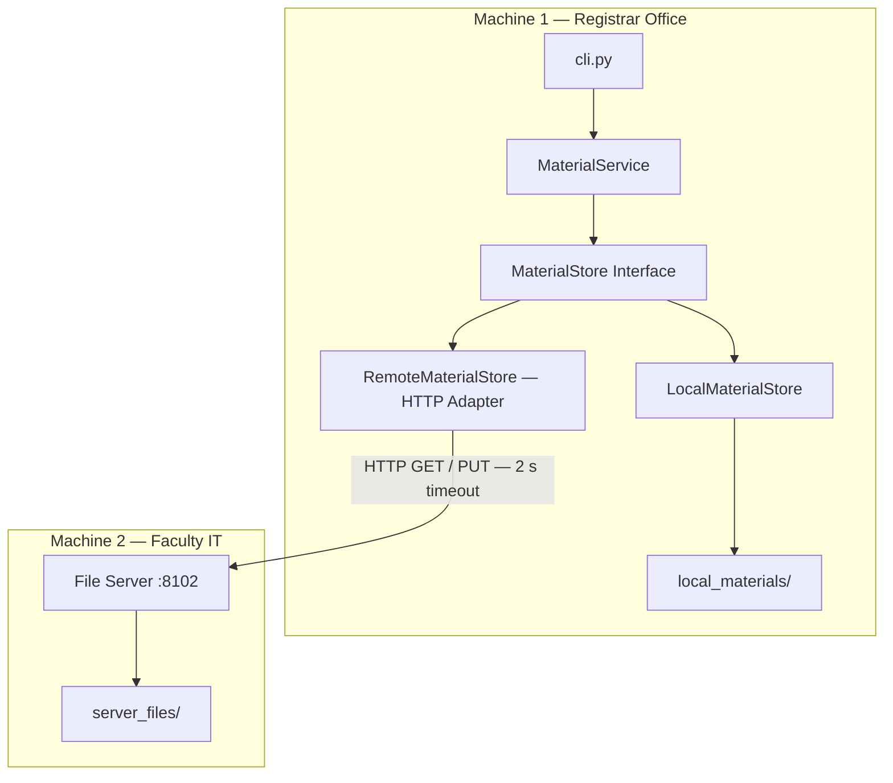

# Week 03 — Architecture Diagram

## Container View

## Network Boundary

The network boundary separates the Registrar application from the Faculty IT file server.

The RemoteMaterialStore adapter handles HTTP communication, timeouts and errors.

The MaterialService depends only on the MaterialStore interface and does not know which implementation is used.

## Failure Handling

- MaterialsUnavailable: server unreachable or timeout.
- MaterialNotFound: requested file does not exist.
- Timeout: 2 seconds for remote requests.
- The student management functionality remains available when the file server is down.
